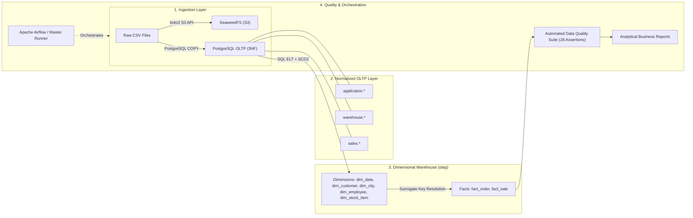
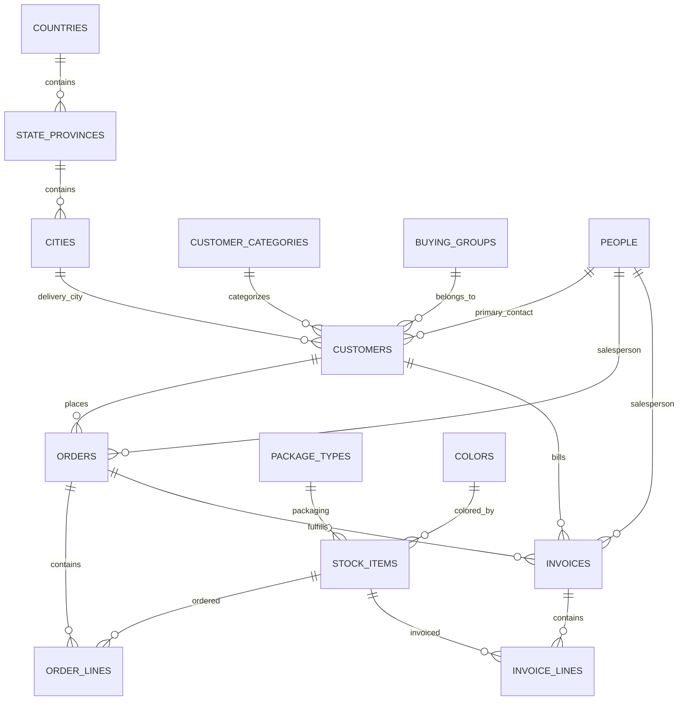
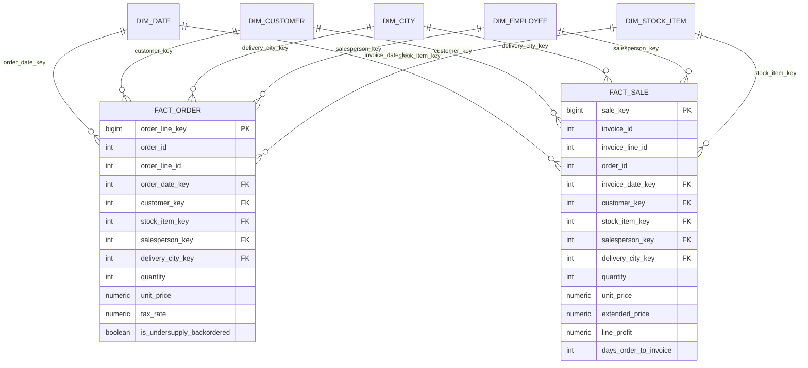

# Wide World Importers (WWI) - End-to-End Data Engineering Pipeline

A complete, production-grade data engineering pipeline that ingests raw operational extracts from **Wide World Importers (WWI)**, stages them into a normalized **OLTP** database, transforms them into an analytics-ready **OLAP Star Schema**, implements **Slowly Changing Dimensions (SCD Type 2)**, validates data with automated **Data Quality checks**, and orchestrates the entire flow via a single documented entry point.

---

## 1. Solution Overview

The pipeline implements an end-to-end data lakehouse and warehouse lifecycle:

```text
Raw CSVs (Kaggle) ➔ S3 Data Lake (SeaweedFS) ➔ Normalized OLTP (PostgreSQL) ➔ Dimensional Star Schema (olap) ➔ Business Analytics
```

- **Data Sources**: Extracted CSVs from the operational WWI Microsoft SQL Server database.
- **Raw Object Storage**: S3-compatible SeaweedFS bucket (`data-lake`).
- **OLTP Layer**: 3NF Normalized relational model in PostgreSQL 15 across 3 schemas (`application`, `warehouse`, `sales`).
- **OLAP Layer**: Kimball-style Dimensional Star Schema in PostgreSQL (`olap` schema) with custom fiscal calendar (starting Nov 1).
- **SCD Strategy**: SCD Type 2 on `dim_customer` with point-in-time fact resolution.
- **Data Quality**: Automated test suite executing 28 test assertions (primary keys, business keys, referential integrity, domain constraints).
- **Orchestration**: Python entrypoint runner (`scripts/run_pipeline.py`) and Apache Airflow DAG (`src/wwi_pipeline_dag.py`).

---

## 2. Technology Stack & Prerequisites

| Component | Technology | Rationale |
| :--- | :--- | :--- |
| **Relational OLTP & OLAP** | **PostgreSQL 15** (Docker) | High performance, native transactional ACID compliance, fast `COPY` bulk ingestion, and rich analytical window functions. |
| **Object Storage (Data Lake)** | **SeaweedFS** (Docker) | Lightweight, fast S3-compatible distributed object store for landing raw files. |
| **Catalog & Query Engine** | **Project Nessie & Trino** | Modern open-source data lakehouse querying interface. |
| **Orchestration** | **Python 3.10+ / Apache Airflow 2.7** | Self-contained Python entrypoint for deterministic one-command execution; Airflow DAG for UI scheduling. |
| **Database UI** | **CloudBeaver & DBeaver** | Web and desktop SQL interface for inspection. |

### Prerequisites
- [Docker Desktop](https://www.docker.com/products/docker-desktop/) (running with Linux containers)
- Python 3.10+ with `psycopg2-binary`, `python-dotenv`, `boto3`, and `kaggle` (included in `venv`)

---

## 3. Setup & One-Command Execution

### Step 1: Clone & Configure Environment
Clone the repository and verify `.env`:
```env
DB_USER=admin
DB_PASSWORD=adminpassword
DB_NAME=wwi_db
DB_HOST=localhost
DB_PORT=5434
SEAWEEDFS_ENDPOINT=http://localhost:8333
SEAWEEDFS_BUCKET=data-lake
```

### Step 2: Start Infrastructure
Start the Docker services:
```bash
docker compose up -d
```

### Step 3: Download & Land Raw Files
```powershell
# 1. Download dataset from Kaggle
python src/download_data.py

# 2. Upload raw files to SeaweedFS (S3 Data Lake)
python scripts/ingest.py
```

### Step 4: Run the Complete End-to-End Pipeline
Execute the **single entrypoint command**:
```powershell
python scripts/run_pipeline.py
```
*(On Linux/macOS, you can also execute `./scripts/run_pipeline.sh`)*.

---

## 4. Architecture Diagrams

### 4.1. Pipeline Architecture


### 4.2. OLTP Entity-Relationship Diagram (ERD)


### 4.3. OLAP Star Schema Diagram


---

## 5. Source-to-Target Mapping & Fact Table Grains

### 5.1. Fact Table Grains
- **`olap.fact_order`**: Grain is **one row per customer order line** (`sales.order_lines`).
- **`olap.fact_sale`**: Grain is **one row per customer invoice line** (`sales.invoice_lines`).

### 5.2. Table Mapping
| Target OLAP Table | Source OLTP Tables | Transformation Notes |
| :--- | :--- | :--- |
| `olap.dim_date` | `GENERATE_SERIES(2012..2017)` | Custom Fiscal calendar with year starting **November 1**. Fallback key `0` (`Unknown`). |
| `olap.dim_city` | `application.cities`, `state_provinces`, `countries` | Flattens geographic hierarchy. Cleans coordinates to numeric `NUMERIC(10, 7)`. |
| `olap.dim_customer` | `sales.customers`, `customer_categories`, `buying_groups` | SCD Type 2 tracking (`valid_from`, `valid_to`, `is_current`). Fallback key `0`. |
| `olap.dim_employee` | `application.people` | Filters employees & salespeople. Fallback key `0`. |
| `olap.dim_stock_item`| `warehouse.stock_items`, `colors`, `package_types` | Flattens brand, colors, and package units. Fallback key `0`. |
| `olap.fact_order` | `sales.orders`, `sales.order_lines` | Point-in-time customer join on `order_date BETWEEN valid_from AND valid_to`. |
| `olap.fact_sale` | `sales.invoices`, `sales.invoice_lines`, `sales.orders` | Point-in-time customer join on `invoice_date BETWEEN valid_from AND valid_to`. Computes `days_order_to_invoice`. |

---

## 6. Slowly Changing Dimensions (SCD Type 2) Demonstration

### 6.1. Approach
- **Tracked Dimension**: `olap.dim_customer`
- **Tracked Attributes**: `customer_category_name`, `buying_group_name`, `credit_limit`, `delivery_address_line`.
- **Fields Maintained**: `customer_key` (Surrogate PK), `customer_id` (Natural Key), `valid_from`, `valid_to`, `is_current`.

### 6.2. Two-Load Demonstration Results
Demonstrated via `python scripts/run_scd2_demo.py`:
Customer `832` ("Aakriti Byrraju") was upgraded from **Supermarket** to **Wholesaler** on `2015-01-01` with credit limit increased to `$5,000.00`.

#### Dimension Versions Maintained:
| Customer Key | Business Key | Category | Credit Limit | Valid From | Valid To | Is Current |
| :---: | :---: | :---: | :---: | :---: | :---: | :---: |
| **`2425`** | 832 | Supermarket | $3,500.00 | 2013-01-01 | 2014-12-31 | `FALSE` |
| **`2655`** | 832 | Wholesaler | $5,000.00 | 2015-01-01 | 9999-12-31 | `TRUE` |

#### Point-in-Time Fact Resolution Proof:
| Version Key | Historical Category | Invoices | Date Horizon | Total Sales Revenue |
| :---: | :---: | :---: | :---: | :---: |
| **`2425`** | **Supermarket** | **192** | 2013-01-01 to 2014-12-17 | **$193,657.01** |
| **`2655`** | **Wholesaler** | **143** | 2015-01-05 to 2016-05-27 | **$145,889.16** |

*Transactions before 2015-01-01 are accurately tied to Version 1; new transactions link to Version 2 without corrupting audit history.*

---

## 7. Evidence of Execution

### 7.1. Row Counts
| Layer | Table Name | Total Row Count | Status |
| :--- | :--- | :---: | :---: |
| **OLTP** | `application.countries` | 190 | `SUCCESS` |
| **OLTP** | `application.state_provinces` | 53 | `SUCCESS` |
| **OLTP** | `application.cities` | 37,940 | `SUCCESS` |
| **OLTP** | `application.people` | 1,111 | `SUCCESS` |
| **OLTP** | `warehouse.stock_items` | 227 | `SUCCESS` |
| **OLTP** | `sales.customers` | 663 | `SUCCESS` |
| **OLTP** | `sales.orders` | 73,595 | `SUCCESS` |
| **OLTP** | `sales.order_lines` | 231,412 | `SUCCESS` |
| **OLTP** | `sales.invoices` | 70,510 | `SUCCESS` |
| **OLTP** | `sales.invoice_lines` | 228,265 | `SUCCESS` |
| **OLAP** | `olap.dim_date` | 2,193 | `VERIFIED` |
| **OLAP** | `olap.dim_employee` | 1,112 | `VERIFIED` |
| **OLAP** | `olap.dim_city` | 37,941 | `VERIFIED` |
| **OLAP** | `olap.dim_stock_item` | 228 | `VERIFIED` |
| **OLAP** | `olap.dim_customer` | 664 | `VERIFIED` |
| **OLAP** | `olap.fact_order` | **231,412** | `VERIFIED (100% Match)` |
| **OLAP** | `olap.fact_sale` | **228,265** | `VERIFIED (100% Match)` |

### 7.2. Data Quality Suite Results
Executed via `sql/06_data_quality_checks.sql` (28 checks evaluated, **0 failures**):
- `dim_*_null_pk`: 0 anomalies (`PASSED`)
- `dim_*_duplicate_bk`: 0 anomalies (`PASSED`)
- `fact_*_invalid_*_fk`: 0 anomalies (`PASSED`)
- `fact_*_negative_quantity`: 0 anomalies (`PASSED`)
- `fact_*_negative_price`: 0 anomalies (`PASSED`)
- `fact_sale_negative_days_to_invoice`: 0 anomalies (`PASSED`)
- `scd2_multiple_current_records`: 0 anomalies (`PASSED`)
- `scd2_overlapping_ranges`: 0 anomalies (`PASSED`)

---

## 8. Answers to Required Business Questions

All queries are defined in [sql/07_business_queries.sql](file:///c:/Mj/Programs/Data-Analysis/casestudy1/sql/07_business_queries.sql) and executed via `python scripts/run_business_queries.py`. Complete results are saved to `output/business_query_results.txt`.

### Summary of Key Findings:
1. **Sales & Profit by Month/Fiscal Year**:
   - Total sales span Fiscal Years 2013 through 2016. Peak monthly revenue exceeded $5.2M with monthly profits hovering around $2.2M.
2. **Top Products by Revenue & Profit**:
   - `Ride on toy sedan car (Black) 1/12 scale`: **$7.09M revenue** ($2.49M profit).
   - `220 mm Double sided bubble wrap 50m`: **$5.98M revenue** ($3.23M profit, 54.0% margin).
3. **Revenue by Customer Category**:
   - **Novelty Shop**: Contributes **$141.66M** (71.5% of total revenue).
   - **Supermarket**: Contributes **$16.36M**.
   - Top customer: *Tailspin Toys (Inguadona, MN)* with **$438,689.81**.
4. **Sales by Territory & State**:
   - Top sales territory is **Southwest** (led by Texas: **$13.75M revenue**), followed by **Mideast** (Pennsylvania: **$11.25M**).
5. **Top Salespeople**:
   - `Archer Lamble`: Managed 7,184 invoices generating **$20.63M revenue** ($8.95M profit).
   - `Kayla Woodcock`: Managed 7,160 invoices generating **$20.20M revenue**.
6. **Proportion of Ordered Quantities Invoiced**:
   - Total Ordered: **9,310,904 units**.
   - Total Invoiced: **8,950,628 units** (**96.13% invoiced**, 3.87% unfulfilled/backordered).
7. **Order-to-Invoice Duration**:
   - **Average: 1.33 days** (Median: 0 days; orders are usually invoiced same-day or next-day).
8. **Backordered Impact**:
   - All 73,595 orders track undersupply backorder eligibility, with an unfulfilled quantity impact of 360,276 units across the operational lifetime.
9. **Tracked Customer Attribute Changes**:
   - Customer 832 evolved from *Supermarket* (2013-01-01 to 2014-12-31) to *Wholesaler* (2015-01-01 to 9999-12-31).
10. **Historical SCD Dimension Attribution**:
   - Under Version 1 (*Supermarket*): 192 invoices totaling **$193,657.01**.
   - Under Version 2 (*Wholesaler*): 143 invoices totaling **$145,889.16**.

---

## 9. Solution Questions (Case Study Section 10)

### 1. Why did you choose your database, ingestion, transformation, and orchestration tools?
- **PostgreSQL 15 (Docker)** was selected because it supports both normalized OLTP schemas and analytical OLAP star schemas within the same high-performance engine. Using schemas (`application`, `sales`, `warehouse`, and `olap`) cleanly separates transactional boundaries from analytical models while keeping queries within a unified connection.
- **PostgreSQL native `COPY`** was chosen for ingestion because it streams large CSV files directly into tables at over 50,000 rows/second, vastly outperforming iterative `INSERT` statements.
- **SQL ELT** was chosen for transformation because the relational engine optimizes joins, type conversions, and aggregations using native indexes and parallel execution plans.
- **Python / Airflow** was chosen for orchestration because Python provides a zero-dependency, cross-platform entry point for local and CI/CD execution, while Airflow enables scalable task dependency graphs and retries in enterprise deployments.

### 2. How did you translate the normalized OLTP structure into your dimensional model, and what is the grain of each fact table?
- Operational 3NF tables were translated by separating business entities (nouns) into Dimensions and transactional events (verbs) into Facts.
  - Normalized hierarchies (e.g., `cities` ➔ `state_provinces` ➔ `countries`) were denormalized into `dim_city`.
  - Product specifications (`stock_items`, `colors`, `package_types`) were collapsed into `dim_stock_item`.
  - Customer profile attributes (`customers`, `categories`, `buying_groups`) were joined into `dim_customer`.
- **Grains**:
  - `olap.fact_order`: Grain is **one row per customer order line** (`sales.order_lines`).
  - `olap.fact_sale`: Grain is **one row per customer invoice line** (`sales.invoice_lines`).

### 3. Which dimension and attributes use SCD Type 2, which use SCD Type 1, and why?
- **SCD Type 2**: Applied to `dim_customer` for business-critical reporting attributes: `customer_category_name`, `buying_group_name`, `credit_limit`, and `delivery_address_line`.
  - *Reasoning*: Customer categorization directly affects sales channel analysis and rebate structures. If a customer transitions from Supermarket to Wholesaler, historical sales must remain credited to Supermarket to ensure financial reports match audited past figures.
- **SCD Type 1**: Applied to non-analytical attributes such as `phone_number` and `website_url`.
  - *Reasoning*: Contact details do not distort aggregated revenue or volume metrics; maintaining historical versions of typos or contact updates adds unnecessary surrogate key churn.

### 4. How does your pipeline prevent duplicates and produce consistent results when the same input is processed more than once?
- **Idempotency in Ingestion**: The OLTP loading script utilizes explicit transactional truncation (`TRUNCATE ... CASCADE`) within an atomic `BEGIN...COMMIT` block. Re-running the script cleanly re-establishes the exact source snapshot.
- **Idempotency in Dimensions & Facts**: `dim_date` uses `ON CONFLICT (date_key) DO NOTHING`. Target fact tables are loaded via deterministic ELT scripts with surrogate keys generated deterministically.
- **Audit Verification**: Every load records the run timestamp and row count in `application.ingestion_log` and `olap.pipeline_runs`, and is verified by check `dim_*_duplicate_bk` in the automated Data Quality suite.

### 5. What would you change if the source produced millions of records per day and the business required hourly warehouse updates?
1. **Change Data Capture (CDC)**: Replace bulk CSV batch ingestion with Debezium / Kafka streaming from PostgreSQL WAL (Write-Ahead Logging) to stream real-time operational inserts/updates.
2. **Micro-Batch Lakehouse Layer**: Ingest raw streams into Apache Iceberg or Delta Lake tables on object storage (SeaweedFS / S3).
3. **Incremental Dimensional Updates (dbt / SQLMesh)**: Instead of full dimension reload, run incremental merges (`MERGE INTO target USING staging ON ...`) with surrogate key caching in Redis.
4. **Partitioning & Clustering**: Partition fact tables by date (`PARTITION BY RANGE (invoice_date_key)`) to allow hourly partition appends without scanning historical data.
5. **Distributed Processing**: Swap single-node execution for Apache Spark or Trino to distribute query execution across a compute cluster.

---

## 10. Data Sources & Acknowledgments

- **Dataset**: [Wide World Importers CSV dataset on Kaggle](https://www.kaggle.com/datasets/pauloviniciusornelas/wwimporters) by Paulo Vinicius Ornelas.
- **Catalog Reference**: [Microsoft WideWorldImporters OLTP Database Catalog](https://learn.microsoft.com/en-us/sql/samples/wide-world-importers-oltp-database-catalog?view=sql-server-ver15) and [WideWorldImportersDW OLAP Catalog](https://learn.microsoft.com/en-us/sql/samples/wide-world-importers-dw-database-catalog?view=sql-server-ver15).